# The Sub-Etha Guide (H2G2)

An all-in-one KDE Plasma 6 widget in the style of *The Hitchhiker's Guide to
the Galaxy*. It covers time, weather, system compute, storage and battery in
one card, with modular sections and installable skins. Don't Panic.

<p align="center">
  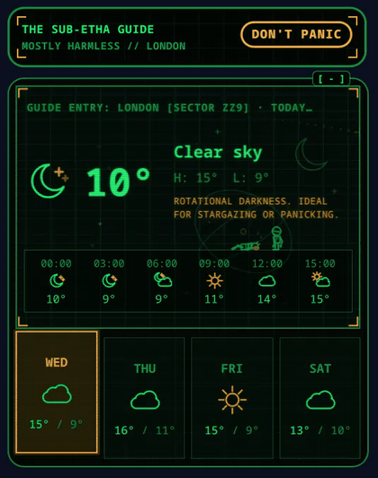
  &nbsp;
  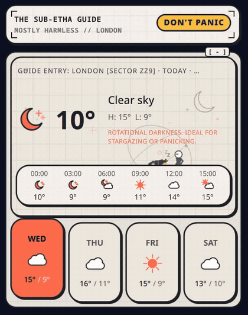
</p>

Two looks: the 2005 film's cream Encyclopedia pages (light) and the 1981 BBC
Sub-Etha terminal's phosphor green on CRT black (dark). **Solar Auto** switches
between them at sunrise and sunset at the weather location. Community
[skins](#skins) from the in-app Theme Store can restyle the whole card.

## Gallery

**Sub-Etha Terminal** (dark): weather, system and storage + power, every
section at Full density.

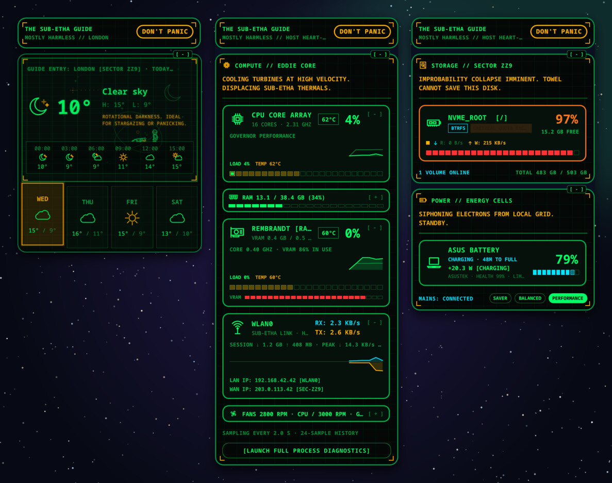

**Movie Encyclopedia** (light): the same sections on cream pages.

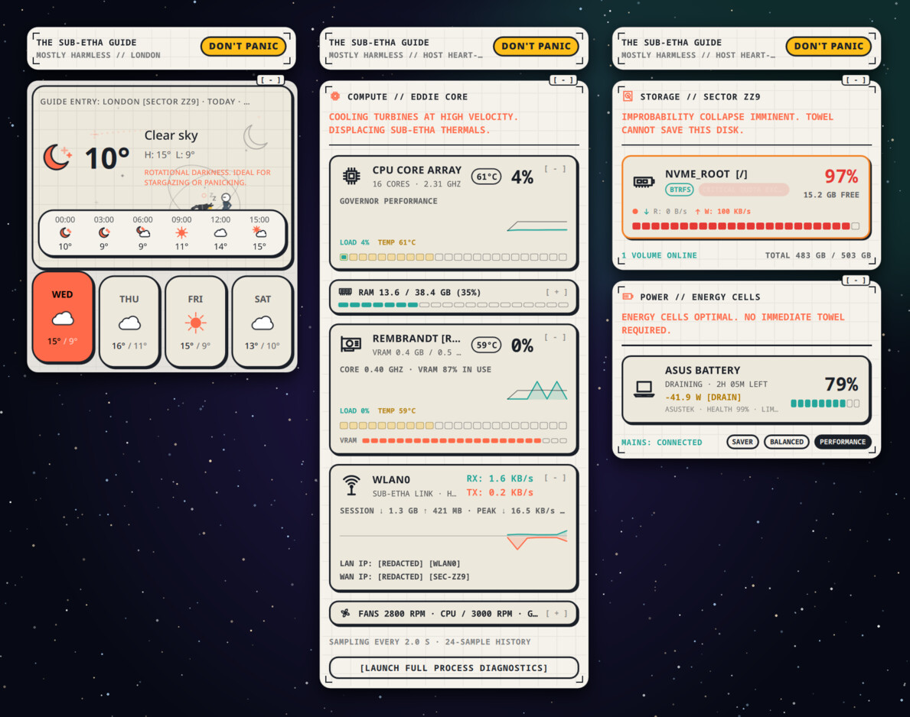

**Compact density**: every section folded to slim pills, in both themes.
Each section switches on its own with the `[ - ]` / `[ + ]` tag on its card.

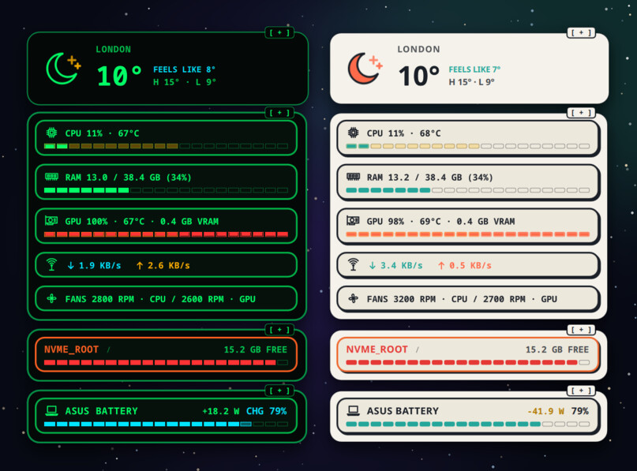

**In a panel**: pick one reading, several at once, or a cycle, with micro
meters. Hovering opens the large card for what the panel shows.

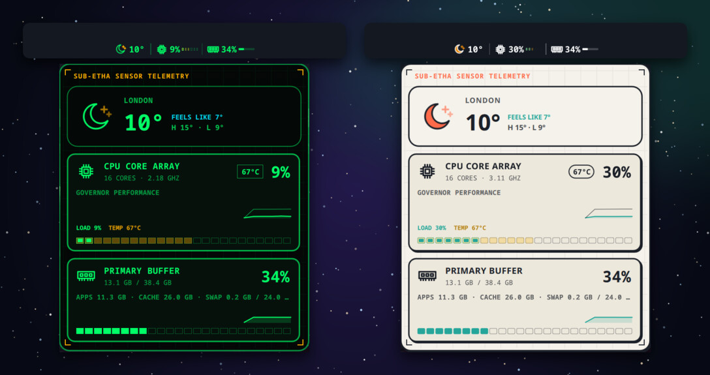

**Alerts**: CPU and GPU temperatures wash orange and then pulse red past
configurable points on their scale. A full disk blinks, and so can a low
battery.

<p align="center">
  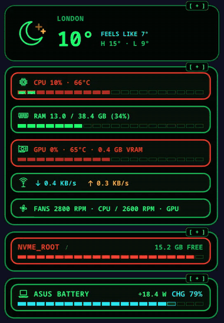
</p>

## Sections

One header (title, location or host name, DON'T PANIC) sits over the
clock, which spans the card, and then four sections in a fixed order:

| Section | Shows |
| --- | --- |
| Clock | Local time, date and time-zone offset as a slim pill or a large chronometer dial; optional Galactic Epoch badge (stardate and sidereal time) |
| Weather | Sky hero card, temperature and feels-like, hourly and weekly drawers, Arthur and Marvin on the forecast strip (Open-Meteo) |
| System | CPU load / clock / temperature, memory, GPU load / temperature / VRAM (pick the GPU on multi-GPU systems), network throughput with LAN / WAN addresses (click to copy), cooling fans; optional host profile banner and 24-sample sparklines; process diagnostics launcher |
| Storage | Selected volumes: usage, free space, filesystem, live read / write throughput (the activity LED pulses past 50 MB/s) |
| Power | Laptop battery and peripherals, live charge / drain wattage, health, mains and power profile |

Each section is **Full** (drawers, graphs, characters) or **Compact** (slim
pills) on its own, and in the System section each sensor card is **Small** or
**Large**. Metrics carry themed tooltips with the detail behind the number.

A section switched off folds away (its height animates to 0) and its feed
stops: no fetches, probes or sensors for a module that isn't shown.

On the desktop the card snaps to fixed layout steps:
- **Width:** 260, 360 or 740 px. At 740 the sections flow into two columns.
- **Height:** 110, 240 or 380 px, then more 110 px rows.

It settles 200 ms after a resize and animates there. Plasma's applet box
follows the resize handle freely, so the card snaps inside it and scrolls
when the content is taller.

## Panel

In a panel the widget shows weather temperature, CPU load or temperature,
GPU temperature, memory, network download or battery, several of them side
by side, or steps through them every few seconds. An icon and a micro meter
per reading are optional. Hovering opens a themed card with the large
version of what the panel shows; clicking opens the full Guide, and a middle
click refreshes it.

## Settings

One tab per module:
- **Appearance & Sections:** theme, per-section density (picked from preview
  cards with hover descriptions), which sections show, and the panel display.
- **Theme Store:** browse, install, update, apply and remove skins (see
  [Skins](#skins)).
- **Clock & Chronometry:** 12 / 24 h, seconds, date, time-zone offset and
  the Galactic Epoch badge.
- **Weather & Location:** place search or detect, units, icon style, update
  interval, background animations, Arthur and Marvin.
- **System Hardware:** which pills and their sizes, GPU, fans, sparklines,
  host profile, temperature unit and colour alerts (warning and critical as
  a share of the 30-100 °C scale), sampling interval.
- **Disks & Storage:** which volumes, throughput, figure and unit, warning
  level.
- **Power & Battery:** which devices, wattage, gauges, estimates, critical
  level and low-battery blink.

**Process diagnostics**: the System section's `[LAUNCH FULL PROCESS
DIAGNOSTICS]` pill (Full mode) and the widget's context menu open the fullest
process monitor available. It tries, in order:
1. a themed companion at `package/contents/tools/subetha-monitor.py`, if present
2. KDE System Monitor
3. KSysGuard
4. otherwise Discover, opened on System Monitor's page to install it

## Skins

The **Theme Store** tab lists the skins in [`skins/registry.json`](skins/registry.json)
on this repository's `main` branch. One click downloads a skin, checks its
SHA-256, installs it under `~/.local/share/subetha/themes/<id>/` and applies
it at once, without restarting Plasma. **Use Built-in Palette** goes back to
the Guide's own look. An installed skin with a newer version in the registry
shows **Update**.

Each skin has a light and a dark look, which follow the widget's Light / Dark / Solar Auto setting (light on the left, dark on the right below).

**Adventure Time (BMO Terminal):** Land of Ooo daytime (candy sky, grass-green cards) or BMO's seafoam circuitry by night, in a handheld chassis with a D-pad, BMO's face screen and face buttons; Finn and Jake walk the forecast strip while the Ice King and Gunter fall through storms.

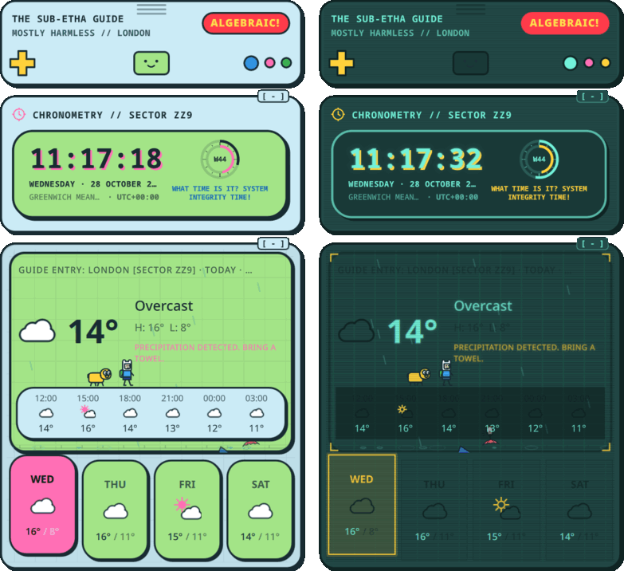

**Cyberpunk 2077 (Arasaka Kiroshi HUD):** Trauma Team platinum medical HUD by day, Kiroshi optics by night: chamfered carbon bezels and pills, tech-bracket borders, cyber-yellow brackets and calibration ticks, scanlines with a rare glitch, stepped sparklines with a danger zone; Johnny Silverhand and a netrunner on a neon ground line; a burning AV and a Trauma Team drone fall through storms.

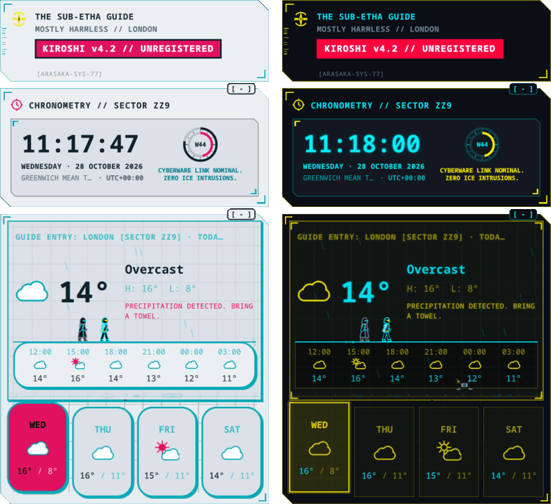

**Mirror's Edge (Runner Vision):** sunlit City of Glass rooftops or midnight infiltration in obsidian and cyan: razor-sharp panels with soft shadows, a Runner Red corner slash, flat gauges and sparklines that turn red above 75 %; Faith sprints and vaults ahead of a scout on a rooftop ledge; a Pirandello Kruger helicopter and a dropped satchel fall through storms.

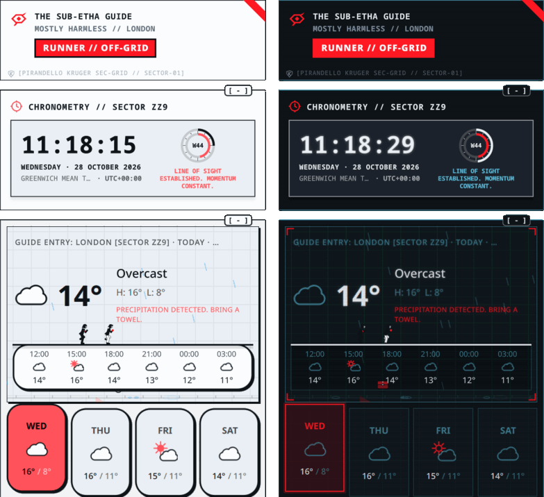

**Dexter's Laboratory (Secret Mainframe):** a clean cream-and-teal lab by day or the midnight violet vault: riveted mainframe with a hazard-striped rail, a DEE DEE PROOF pushbutton and two analog dials for load and heat, graduated segment gauges; Dexter marches while Dee Dee dances behind him, and on hover or a load spike she reaches for the button and he panics; a spilling beaker and an exploded prototype gear fall through storms.

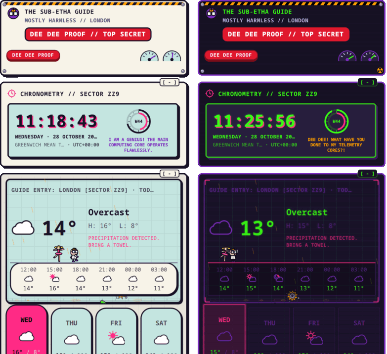

The skins are fan-made. The characters and names belong to their owners.

**Skins are data, not code.** A skin is a `skin.json` plus SVG and PNG
images. It never ships QML, so installing one can't run anything. The
widget draws everything with its own components: the chassis and bezel
frames, the sprite walkers, gauges and graphs. `skin.json` only chooses
which of them to use and with what:

- **`colors`:** background, cards, text, accents, border width / radius /
  shadow, gauge track / fill / edge, sparkline style and colours (`stepped`,
  a `sparklineDanger` band, a `sparklineHot` colour past a load), network
  colours and the commentary colour.
- **`geometry`:** the shape of every card, pill, gauge and button.
  `cardShape` / `pillShape` (`rounded`, `chamfer`, `sharp`, `stadium`),
  `gaugeShape` (`segmented`, `flat`, `stadium`, `chamfer`), `cornerRadius` /
  `pillRadius`, `chamferCut` / `pillChamferCut`, `borderStyle` (`solid`,
  `dashed`, `double`, `tech-brackets`), `borderWidth`, `hasCornerBrackets`,
  and the shadow: `hasDropShadow`, `shadowType` (`flat-2d`, `soft`, `glow`,
  `none`), `shadowOffset`, `shadowBlur` (px). Left out, the shapes follow
  the older `colors` radius / shadow tokens and the frame's chamfer.
- **`variants`:** a `light` and a `dark` look. Each one lays `colors`
  (same keys), `badgeColor` / `badgeTextColor`, frame colours (`dpad`,
  `buttons`, `brackets`, `slash`, `watermarkColor`, `rivets`, `dials`,
  `hazard`, `button.color`) and `ground` colours over the base. A skin with
  both follows the Guide's Light / Dark / Solar Auto setting; one without
  keeps the single look `isDark` names.
- **`clockQuips`:** the clock's `nominal` line and its `stress` line (on a
  critical reading or a busy CPU).
- **`narrativeAssets`:** `fallingSkyHazard` and `hazardSecondary`, two
  images that tumble down the weather hero in rain and thunder in place of
  the whale and the bowl of petunias. `primaryRoamer` / `secondaryRoamer` /
  `badgeText` / `badgeColor` are short forms of `roamers` and the badge.
- **`isDark`, `fontFamily`, `badgeText` / `badgeColor` / `badgeTextColor`.**
- **`commentaryTemplates`:** the System section's lines for nominal,
  moderate, high load, critical and night.
- **`frame`:** `"handheld"` (vents, D-pad, face screen and buttons) or
  `"bezel"`. A bezel can have chamfered corners, brackets, calibration
  ticks, a corner slash, a hazard rail, rivets, a pushbutton, analog dials,
  a logo beside the title, a watermark, an alert icon, scanlines and a
  glitch.
- **`faces`:** idle, happy and stressed images for the handheld face screen.
- **`roamers`:** walk frames, plus optional idle, vault and alert frames, with
  size, spacing and stride, `bob` / `stretch` / `notes` / `waves`, and
  `havoc`. **`ground`:** the line they walk on, its alert colour, ledge and
  pulse dots.
- **`labels`:** renames the network RX / TX readouts and the LAN / WAN
  labels and tags. **`netGlyph`:** `"chevron"` for chevrons instead of
  arrows.

The widget checks every value when the skin loads: colours must be hex or
`rgb()` / `rgba()`, images must be inside the skin's folder, and numbers
are clamped. Anything malformed is dropped.

To add a skin, create `skins/<id>/` with its `skin.json`, `preview.png`
(360×220) and `assets/`, then run:

```sh
tools/package_skins.sh   # builds skins/dist/<id>.tar.gz and rewrites skins/registry.json
```

The archives are reproducible, so an unchanged skin keeps its hash. Push to
`main` and the skin appears in every widget's Theme Store. The installer
(`package/contents/tools/skin_installer.sh install|remove|list`) accepts
only HTTPS archives of up to 5 MiB. It checks the checksum and refuses
links, absolute paths and `..`, and moves the skin into place only once it
has unpacked completely.

## Languages

English, German, Dutch, French and Spanish, following the system language.
The translations live in `translate/`; after changing any text, run
`./translate/build.sh` to refresh the template, merge it into every language
and compile them into the package. To add a language:

```sh
msginit -i translate/template.pot -o translate/<lang>.po -l <lang>
```

## Install

```sh
./install.sh            # install or upgrade
./install.sh --restart  # ...and restart plasmashell
```

Then add **The Sub-Etha Guide (H2G2)** from the Widget Explorer (System
Information).

## System Monitor app

The [Sub-Etha System Monitor](../subetha-monitor), a separate project, is
a standalone companion window in the same two themes: live telemetry, a
process table with SIGTERM / SIGKILL, systemd unit control, network and
storage tabs, and fans that spin at their real RPM. Once it is installed
(its `install.sh` puts `subetha-monitor` on the app menu and in
`~/.local/bin`), the widget's diagnostics button opens it on the Processes
tab; without it, the button falls back to KDE's System Monitor.

## Layout

```text
package/                       the Plasma applet (com.shani.subethaguide)
├── metadata.json
└── contents/
    ├── config/                main.xml (settings), config.qml (tabs)
    ├── locale/                compiled translations
    ├── tools/                 skin_installer.sh (Theme Store downloads)
    └── ui/
        ├── main.qml           feeds, theme, skin engine, actions, representations
        ├── FullRepresentation.qml, *Section.qml, ModuleCard.qml
        ├── CompactRepresentation.qml, PanelReadings.qml, PanelHoverPopup.qml
        ├── config*.qml, PreviewCard.qml, configSkinStore.qml (Theme Store)
        ├── common/            theme, frames, pills, snapping, sparklines, tooltips, i18n,
        │                      TimeEngine, SkinEngine, HandheldChassis, BezelShape, BezelDecor
        ├── clock/             ClockPanel, ChronoDial
        ├── weather/           WeatherFeed, FullView, MinimalView, characters, SpriteRoamers, icons
        ├── system/            SystemFeed, SystemPanel, pills, SpecsBanner
        ├── disk/              DiskFeed, DiskPanel, DiskPillCard, VolumePicker
        └── battery/           BatteryFeed, BatteryPanel, BatteryPillCard, DevicePicker
skins/                         community skins: <id>/ sources, dist/ archives, registry.json
tools/                         package_skins.sh
translate/                     template.pot, <lang>.po, build.sh
docs/screenshots/              the images above
```

## Data sources

- **Weather**: [Open-Meteo](https://open-meteo.com/), no API key.
- **System**: Plasma's sensor daemon (`ksystemstats`, through
  `org.kde.ksysguard.sensors`), throttled to the update interval. It runs
  only while the card is on screen and the session is unlocked. The host
  profile is read once: `/proc/cpuinfo`, `lspci`, memory type from the DMI
  tables through udev (no root), `uname` and `/etc/os-release`.
- **Network identity**: local address, gateway and DNS from `ip` and
  `resolvectl`; the public address from [ipify](https://www.ipify.org/),
  at most once every 15 minutes and only while the network card is shown.
- **Storage**: one `df` + `lsblk` + `/proc/diskstats` probe, every 2 s while
  on screen and once a minute otherwise.
- **Theme Store**: `skins/registry.json` and the skin archives and previews
  from `raw.githubusercontent.com`, fetched only while the Theme Store tab is
  open or a skin is installing.
- **Power**: Plasma's `powermanagement` engine (UPower). Wattage comes from
  ksystemstats' `power/battery_*/chargeRate`, falling back to
  `/sys/class/power_supply/BAT*/power_now`.

Screenshots use a London forecast and placeholder network addresses.

Licensed GPL-2.0-or-later (see `LICENSE`).
